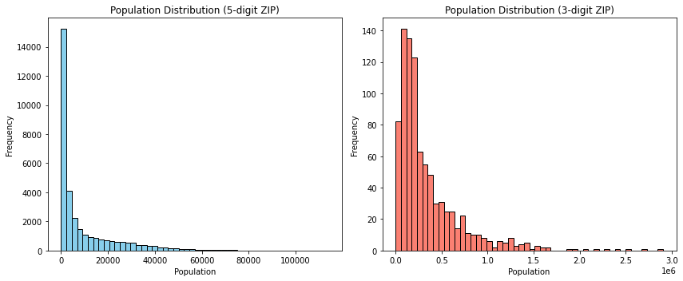
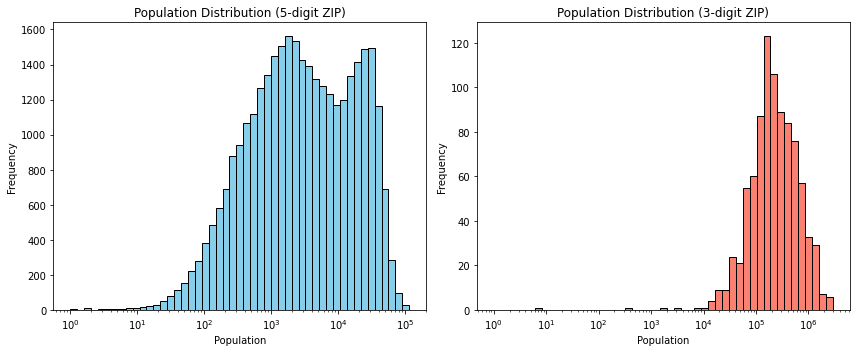

Log transformation is often discussed while handling skewed data, but its application to create better histograms remains under appreciated.

Here's the difference between two plots, one without using linear bins and using logarithmic bins. 

**Linear bins:**

**Logarithmic bins:**

Plenty of real-world data follow [log-normal distribution](https://en.wikipedia.org/wiki/Log-normal_distribution#Occurrence_and_applications) - population, income, size of media files to name a few.

### Code

